# CAUDERS WEBSITE — COMPLETE SITE MAP & ROUTE ARCHITECTURE SPECIFICATION

**Document Version:** 1.0  
**Effective Date:** October 2026  
**Target Domain:** `https://www.cauders.com`  
**Application Architecture:** Next.js 14+ (App Router, Server-Side Rendering & Static Generation)  
**Total Canonical Routes Documented:** 63 routes (59 indexable endpoints + 3 architectural redirect hubs + 1 server action endpoint)  
**Repository Branch:** `staging`  

---

## 1. Executive Summary & Site Architecture Overview

This document provides the authoritative, exhaustive site map and structural hierarchy for the **Cauders** official enterprise website (`cauders.com`). Cauders positions itself as an elite custom software engineering, applied artificial intelligence, and workflow automation firm.

### 1.1 Architectural Pillars

The website navigation and routing hierarchy is organized into seven core operational pillars:

1. **Homepage & Conversion Hubs:** Root discovery portal, service previews, technical capability showcases, interactive case evidence, and lead capture.
2. **Core Software & Cloud Engineering Services (`/services/...`):** 6 service category hubs and 13 individual service detail pages.
3. **Applied AI, Machine Learning & Automation Services (`/ai/...`):** 5 AI category hubs and 12 specialized AI/ML service detail pages.
4. **Industry Vertical Solutions (`/industries/...`):** 8 specialized industry transformation pages.
5. **Company, Culture, Leadership & Careers:** About us, executive leadership, engineering disciplines, active job board, application portal, and partner network.
6. **Inquiry, Support & Engagement:** Dedicated technical discovery contact, categorized FAQs, and partner/client feedback collection.
7. **Legal Governance & Trust:** Privacy policy, terms of service, and cookies compliance.

---

## 2. Visual Architecture Diagram (Mermaid Hierarchy)

```mermaid
graph TD
    Root["https://www.cauders.com (/)"]

    %% Core Services Pillar
    Root --> ServicesHub["/services (Redirect Hub)"]
    ServicesHub --> CatSoftware["/services/software-solutions"]
    ServicesHub --> CatDesign["/services/design-digital-commerce"]
    ServicesHub --> CatCloud["/services/cloud-digital-transformation"]
    ServicesHub --> CatQA["/services/quality-assurance-cybersecurity"]
    ServicesHub --> CatStaff["/services/staff-augmentation"]
    ServicesHub --> CatMaint["/services/maintenance-support"]

    CatSoftware --> WebDev["/services/software-solutions/web-development"]
    CatSoftware --> MobDev["/services/software-solutions/mobile-app-development"]
    CatSoftware --> CustSoft["/services/software-solutions/custom-software-development"]
    CatSoftware --> SaaS["/services/software-solutions/saas-development"]

    CatDesign --> UIUX["/services/design-digital-commerce/ui-ux-design"]

    CatCloud --> CloudTrans["/services/cloud-digital-transformation/cloud-transformation"]
    CatCloud --> DigConsult["/services/cloud-digital-transformation/digital-consulting-strategy"]
    CatCloud --> BizApps["/services/cloud-digital-transformation/business-applications"]

    CatQA --> QA["/services/quality-assurance-cybersecurity/quality-assurance"]
    CatQA --> SoftTesting["/services/quality-assurance-cybersecurity/software-testing"]
    CatQA --> CyberSec["/services/quality-assurance-cybersecurity/cybersecurity-compliance"]

    CatStaff --> StaffOff["/services/staff-augmentation/staff-augmentation-offshoring"]
    CatMaint --> AppMaint["/services/maintenance-support/application-maintenance-support"]

    %% AI Pillar
    Root --> AIHub["/ai (Redirect Hub)"]
    AIHub --> AICatStrategy["/ai/ai-strategy-advisory"]
    AIHub --> AICatProduct["/ai/ai-product-engineering"]
    AIHub --> AICatGenAI["/ai/generative-ai-llms"]
    AIHub --> AICatGov["/ai/enterprise-ai-governance"]
    AIHub --> AICatData["/ai/data-intelligent-automation"]

    AICatStrategy --> AIRoadmap["/ai/ai-strategy-advisory/ai-roadmapping-consulting"]
    AICatStrategy --> AIReady["/ai/ai-strategy-advisory/ai-readiness-assessments"]

    AICatProduct --> CustAI["/ai/ai-product-engineering/custom-ai-development"]
    AICatProduct --> ML["/ai/ai-product-engineering/machine-learning-solutions"]
    AICatProduct --> AIAPI["/ai/ai-product-engineering/ai-integration-apis"]

    AICatGenAI --> GenAISol["/ai/generative-ai-llms/generative-ai-solutions"]
    AICatGenAI --> AIAgents["/ai/generative-ai-llms/autonomous-ai-agents"]
    AICatGenAI --> AIMVP["/ai/generative-ai-llms/rapid-ai-prototyping"]

    AICatGov --> CorpAuto["/ai/enterprise-ai-governance/corporate-ai-automation"]
    AICatGov --> AISec["/ai/enterprise-ai-governance/ai-security-compliance"]

    AICatData --> DataMod["/ai/data-intelligent-automation/data-modernization-analytics"]
    AICatData --> AutoApps["/ai/data-intelligent-automation/automation-custom-applications"]

    %% Industries Pillar
    Root --> IndHub["/industries (Redirect Hub)"]
    IndHub --> IndHealth["/industries/healthcare"]
    IndHub --> IndFin["/industries/banking-financial-services"]
    IndHub --> IndRetail["/industries/retail-ecommerce"]
    IndHub --> IndTech["/industries/technology-software"]
    IndHub --> IndStart["/industries/startups-high-growth"]
    IndHub --> IndLog["/industries/logistics-supply-chain"]
    IndHub --> IndEdu["/industries/education-elearning"]
    IndHub --> IndReal["/industries/real-estate"]

    %% Company & Support Pillar
    Root --> About["/about"]
    Root --> Team["/team"]
    Root --> Careers["/careers"]
    Careers --> Apply["/careers/apply"]
    Root --> Partners["/partners"]
    Root --> Contact["/contact"]
    Root --> FAQ["/faq"]
    Root --> Feedback["/feedback"]

    %% Legal Pillar
    Root --> Privacy["/privacy-policy"]
    Root --> Terms["/terms-of-service"]
    Root --> Cookies["/cookies-policy"]
```



---

## 3. Exhaustive Master Route Directory

The table below catalogs every routable path in the application, including rendering mechanics, static generation parameters, HTTP status behaviors, crawl prioritization, and expected search engine indexing settings.

| # | Route / URL Path | Page Title / Purpose | Source Component / Route File | Route Type | Crawl Index | SEO Priority | Change Freq |
|---|---|---|---|---|---|---|---|
| **1** | `/` | Home — AI, Automation & Software Solutions | `src/app/page.tsx` | Static SSG | Index / Follow | 1.0 | Weekly |
| **2** | `/about` | About Us — Vision, Principles & Leadership | `src/app/about/page.tsx` | Static SSG | Index / Follow | 0.8 | Monthly |
| **3** | `/team` | Our Team — Leadership & Delivery Disciplines | `src/app/team/page.tsx` | Static SSG | Index / Follow | 0.7 | Monthly |
| **4** | `/services` | Services Overview / Category Router | `src/app/services/page.tsx` | Server 307 Redirect | Noindex / Follow | 0.6 | Monthly |
| **5** | `/services/software-solutions` | Software Solutions Category Hub | `src/app/services/[category]/page.tsx` | Dynamic SSG (`generateStaticParams`) | Index / Follow | 0.9 | Weekly |
| **6** | `/services/software-solutions/web-development` | Web Development Services Detail | `src/app/services/[category]/[service]/page.tsx` | Dynamic SSG (`generateStaticParams`) | Index / Follow | 0.9 | Weekly |
| **7** | `/services/software-solutions/mobile-app-development` | Mobile App Development Services Detail | `src/app/services/[category]/[service]/page.tsx` | Dynamic SSG (`generateStaticParams`) | Index / Follow | 0.9 | Weekly |
| **8** | `/services/software-solutions/custom-software-development` | Custom Software Development Detail | `src/app/services/[category]/[service]/page.tsx` | Dynamic SSG (`generateStaticParams`) | Index / Follow | 0.9 | Weekly |
| **9** | `/services/software-solutions/saas-development` | SaaS Architecture & Development Detail | `src/app/services/[category]/[service]/page.tsx` | Dynamic SSG (`generateStaticParams`) | Index / Follow | 0.9 | Weekly |
| **10** | `/services/design-digital-commerce` | Design Category Hub | `src/app/services/[category]/page.tsx` | Dynamic SSG (`generateStaticParams`) | Index / Follow | 0.8 | Monthly |
| **11** | `/services/design-digital-commerce/ui-ux-design` | UI/UX & Product Design Services Detail | `src/app/services/[category]/[service]/page.tsx` | Dynamic SSG (`generateStaticParams`) | Index / Follow | 0.9 | Weekly |
| **12** | `/services/cloud-digital-transformation` | Digital Transformation Category Hub | `src/app/services/[category]/page.tsx` | Dynamic SSG (`generateStaticParams`) | Index / Follow | 0.8 | Monthly |
| **13** | `/services/cloud-digital-transformation/cloud-transformation` | Cloud & Infrastructure Migration Detail | `src/app/services/[category]/[service]/page.tsx` | Dynamic SSG (`generateStaticParams`) | Index / Follow | 0.9 | Weekly |
| **14** | `/services/cloud-digital-transformation/digital-consulting-strategy` | Digital Consulting & Strategy Detail | `src/app/services/[category]/[service]/page.tsx` | Dynamic SSG (`generateStaticParams`) | Index / Follow | 0.8 | Monthly |
| **15** | `/services/cloud-digital-transformation/business-applications` | Business Applications & ERP/CRM Detail | `src/app/services/[category]/[service]/page.tsx` | Dynamic SSG (`generateStaticParams`) | Index / Follow | 0.8 | Monthly |
| **16** | `/services/quality-assurance-cybersecurity` | QA & Cybersecurity Category Hub | `src/app/services/[category]/page.tsx` | Dynamic SSG (`generateStaticParams`) | Index / Follow | 0.8 | Monthly |
| **17** | `/services/quality-assurance-cybersecurity/quality-assurance` | Quality Assurance Strategy Detail | `src/app/services/[category]/[service]/page.tsx` | Dynamic SSG (`generateStaticParams`) | Index / Follow | 0.8 | Monthly |
| **18** | `/services/quality-assurance-cybersecurity/software-testing` | Software Testing & Automation Detail | `src/app/services/[category]/[service]/page.tsx` | Dynamic SSG (`generateStaticParams`) | Index / Follow | 0.8 | Monthly |
| **19** | `/services/quality-assurance-cybersecurity/cybersecurity-compliance` | Application Security & Compliance Detail | `src/app/services/[category]/[service]/page.tsx` | Dynamic SSG (`generateStaticParams`) | Index / Follow | 0.8 | Monthly |
| **20** | `/services/staff-augmentation` | Staff Augmentation Category Hub | `src/app/services/[category]/page.tsx` | Dynamic SSG (`generateStaticParams`) | Index / Follow | 0.8 | Monthly |
| **21** | `/services/staff-augmentation/staff-augmentation-offshoring` | Staff Augmentation & Dedicated Teams Detail | `src/app/services/[category]/[service]/page.tsx` | Dynamic SSG (`generateStaticParams`) | Index / Follow | 0.8 | Monthly |
| **22** | `/services/maintenance-support` | Maintenance & Support Category Hub | `src/app/services/[category]/page.tsx` | Dynamic SSG (`generateStaticParams`) | Index / Follow | 0.8 | Monthly |
| **23** | `/services/maintenance-support/application-maintenance-support` | Application Maintenance & Support Detail | `src/app/services/[category]/[service]/page.tsx` | Dynamic SSG (`generateStaticParams`) | Index / Follow | 0.8 | Monthly |
| **24** | `/ai` | AI Overview / Routing Redirect | `src/app/ai/page.tsx` | Server 307 Redirect | Noindex / Follow | 0.6 | Monthly |
| **25** | `/ai/ai-strategy-advisory` | AI Strategy & Advisory Category Hub | `src/app/ai/[category]/page.tsx` | Dynamic SSG (`generateStaticParams`) | Index / Follow | 0.9 | Weekly |
| **26** | `/ai/ai-strategy-advisory/ai-roadmapping-consulting` | AI Roadmapping & Consulting Detail | `src/app/ai/[category]/[service]/page.tsx` | Dynamic SSG (`generateStaticParams`) | Index / Follow | 0.9 | Weekly |
| **27** | `/ai/ai-strategy-advisory/ai-readiness-assessments` | AI Readiness Assessments Detail | `src/app/ai/[category]/[service]/page.tsx` | Dynamic SSG (`generateStaticParams`) | Index / Follow | 0.8 | Monthly |
| **28** | `/ai/ai-product-engineering` | AI Product Engineering Category Hub | `src/app/ai/[category]/page.tsx` | Dynamic SSG (`generateStaticParams`) | Index / Follow | 0.9 | Weekly |
| **29** | `/ai/ai-product-engineering/custom-ai-development` | Custom AI Development Detail | `src/app/ai/[category]/[service]/page.tsx` | Dynamic SSG (`generateStaticParams`) | Index / Follow | 0.9 | Weekly |
| **30** | `/ai/ai-product-engineering/machine-learning-solutions` | Machine Learning Solutions Detail | `src/app/ai/[category]/[service]/page.tsx` | Dynamic SSG (`generateStaticParams`) | Index / Follow | 0.9 | Weekly |
| **31** | `/ai/ai-product-engineering/ai-integration-apis` | AI Integration & APIs Detail | `src/app/ai/[category]/[service]/page.tsx` | Dynamic SSG (`generateStaticParams`) | Index / Follow | 0.9 | Weekly |
| **32** | `/ai/generative-ai-llms` | Generative AI & LLMs Category Hub | `src/app/ai/[category]/page.tsx` | Dynamic SSG (`generateStaticParams`) | Index / Follow | 0.9 | Weekly |
| **33** | `/ai/generative-ai-llms/generative-ai-solutions` | Generative AI Solutions Detail | `src/app/ai/[category]/[service]/page.tsx` | Dynamic SSG (`generateStaticParams`) | Index / Follow | 0.9 | Weekly |
| **34** | `/ai/generative-ai-llms/autonomous-ai-agents` | Autonomous AI Agents Detail | `src/app/ai/[category]/[service]/page.tsx` | Dynamic SSG (`generateStaticParams`) | Index / Follow | 0.9 | Weekly |
| **35** | `/ai/generative-ai-llms/rapid-ai-prototyping` | Rapid AI Prototyping (MVP) Detail | `src/app/ai/[category]/[service]/page.tsx` | Dynamic SSG (`generateStaticParams`) | Index / Follow | 0.8 | Monthly |
| **36** | `/ai/enterprise-ai-governance` | Enterprise AI & Governance Category Hub | `src/app/ai/[category]/page.tsx` | Dynamic SSG (`generateStaticParams`) | Index / Follow | 0.8 | Monthly |
| **37** | `/ai/enterprise-ai-governance/corporate-ai-automation` | Corporate AI Automation Detail | `src/app/ai/[category]/[service]/page.tsx` | Dynamic SSG (`generateStaticParams`) | Index / Follow | 0.8 | Monthly |
| **38** | `/ai/enterprise-ai-governance/ai-security-compliance` | AI Security & Compliance Detail | `src/app/ai/[category]/[service]/page.tsx` | Dynamic SSG (`generateStaticParams`) | Index / Follow | 0.8 | Monthly |
| **39** | `/ai/data-intelligent-automation` | Data & Intelligent Automation Hub | `src/app/ai/[category]/page.tsx` | Dynamic SSG (`generateStaticParams`) | Index / Follow | 0.9 | Weekly |
| **40** | `/ai/data-intelligent-automation/data-modernization-analytics` | Data Modernization & Analytics Detail | `src/app/ai/[category]/[service]/page.tsx` | Dynamic SSG (`generateStaticParams`) | Index / Follow | 0.9 | Weekly |
| **41** | `/ai/data-intelligent-automation/automation-custom-applications` | Automation & Custom Applications Detail | `src/app/ai/[category]/[service]/page.tsx` | Dynamic SSG (`generateStaticParams`) | Index / Follow | 0.9 | Weekly |
| **42** | `/industries` | Industries Overview / Routing Redirect | `src/app/industries/page.tsx` | Server 307 Redirect | Noindex / Follow | 0.6 | Monthly |
| **43** | `/industries/healthcare` | Healthcare & Life Sciences Digital Solutions | `src/app/industries/[industry]/page.tsx` | Dynamic SSG (`generateStaticParams`) | Index / Follow | 0.8 | Monthly |
| **44** | `/industries/banking-financial-services` | Banking, Fintech & Financial Services | `src/app/industries/[industry]/page.tsx` | Dynamic SSG (`generateStaticParams`) | Index / Follow | 0.8 | Monthly |
| **45** | `/industries/retail-ecommerce` | Retail, Consumer & E-Commerce Engineering | `src/app/industries/[industry]/page.tsx` | Dynamic SSG (`generateStaticParams`) | Index / Follow | 0.8 | Monthly |
| **46** | `/industries/technology-software` | Technology, SaaS & Software Companies | `src/app/industries/[industry]/page.tsx` | Dynamic SSG (`generateStaticParams`) | Index / Follow | 0.8 | Monthly |
| **47** | `/industries/startups-high-growth` | High-Growth Startups & Scaleups | `src/app/industries/[industry]/page.tsx` | Dynamic SSG (`generateStaticParams`) | Index / Follow | 0.8 | Monthly |
| **48** | `/industries/logistics-supply-chain` | Logistics, Freight & Supply Chain Systems | `src/app/industries/[industry]/page.tsx` | Dynamic SSG (`generateStaticParams`) | Index / Follow | 0.8 | Monthly |
| **49** | `/industries/education-elearning` | Education, Universities & EdTech Platforms | `src/app/industries/[industry]/page.tsx` | Dynamic SSG (`generateStaticParams`) | Index / Follow | 0.8 | Monthly |
| **50** | `/industries/real-estate` | Real Estate & PropTech Digital Platforms | `src/app/industries/[industry]/page.tsx` | Dynamic SSG (`generateStaticParams`) | Index / Follow | 0.8 | Monthly |
| **51** | `/careers` | Careers & Open Engineering Opportunities | `src/app/careers/page.tsx` | Static SSG | Index / Follow | 0.7 | Weekly |
| **52** | `/careers/apply` | Candidate Job Application Submission | `src/app/careers/apply/page.tsx` | Static Client Form | Index / NoFollow | 0.5 | Monthly |
| **53** | `/partners` | Strategic Technology & Delivery Alliances | `src/app/partners/page.tsx` | Static SSG | Index / Follow | 0.7 | Monthly |
| **54** | `/contact` | Technical Discovery & Project Inquiry | `src/app/contact/page.tsx` | Static SSG | Index / Follow | 0.9 | Monthly |
| **55** | `/faq` | Frequently Asked Questions | `src/app/faq/page.tsx` | Static SSG | Index / Follow | 0.7 | Monthly |
| **56** | `/feedback` | Client & Partner Feedback Channel | `src/app/feedback/page.tsx` | Static SSG | Index / Follow | 0.5 | Monthly |
| **57** | `/privacy-policy` | Privacy Policy & Data Processing Notice | `src/app/privacy-policy/page.tsx` | Static SSG | Index / Follow | 0.4 | Yearly |
| **58** | `/terms-of-service` | Terms of Service & Engagement Conditions | `src/app/terms-of-service/page.tsx` | Static SSG | Index / Follow | 0.4 | Yearly |
| **59** | `/cookies-policy` | Cookies Policy & Tracking Notice | `src/app/cookies-policy/page.tsx` | Static SSG | Index / Follow | 0.4 | Yearly |
| **60** | `/not-found` (404) | Custom Error Page Not Found State | `src/app/not-found.tsx` | Client Error State | Noindex / Nofollow | 0.0 | Never |
| **61** | `/#portfolio-preview` | Selected Evidence & Production Systems | `src/components/cauders/PortfolioPreview.tsx` | In-page Anchor | N/A (Anchor) | N/A | N/A |
| **62** | `/#contact-form` | Homepage Lead Discovery Form Anchor | `src/components/cauders/HomePageContact.tsx` | In-page Anchor | N/A (Anchor) | N/A | N/A |
| **63** | `src/app/actions.ts` | Server Actions (Forms / Nodemailer Endpoints) | `src/app/actions.ts` | API / Server Action | Non-HTML Action | N/A | N/A |

---

## 4. Deep-Dive Sectional Breakdowns

### 4.1 Pillar 1: Homepage & Conversion Architecture (`/`)
- **SEO Title:** `Cauders | AI, Automation & Software Solutions`
- **Meta Description:** `Cauders designs, builds, and modernizes custom software, SaaS products, applied AI, and workflow automations engineered around your business operations.`
- **Canonical URL:** `https://www.cauders.com/`
- **Primary Hero (`/`):** Strategic headline emphasizing custom engineering, automation, and AI.
- **Intro Section (`/#intro`):** Brand showcase: "Transforming Business Challenges into Solutions Through Technology & Applied AI".
- **Capabilities Preview (`/#capabilities`):** Categorized view of core software, AI platforms, and cloud engineering.
- **Why Choose Cauders (`/#why-choose-us`):** 4 capability pillars (Architectural Precision, Scalable Modular Codebases, Applied Practical Intelligence, Transparent Engagement).
- **Systems & Solutions in Production (3D Coverflow):** Visual presentation of responsive platforms, high-throughput backend services, and real-time dashboards.
- **Selected Evidence Carousel (`/#portfolio-preview`):** Anonymized project case cards with implementation stacks (React, Next.js, Node.js, Python, Flutter).
- **Interactive FAQ Accordion:** Common pre-sales inquiries with direct contact links.
- **Technical Discovery Form (`/#contact-form`):** Full lead-capture form validating project scope, company size, timeline, and email.

### 4.2 Pillar 2: Core Software & Cloud Engineering Services (`/services/...`)

```
/services/
├── software-solutions/
│   ├── web-development
│   ├── mobile-app-development
│   ├── custom-software-development
│   └── saas-development
├── design-digital-commerce/
│   └── ui-ux-design
├── cloud-digital-transformation/
│   ├── cloud-transformation
│   ├── digital-consulting-strategy
│   └── business-applications
├── quality-assurance-cybersecurity/
│   ├── quality-assurance
│   ├── software-testing
│   └── cybersecurity-compliance
├── staff-augmentation/
│   └── staff-augmentation-offshoring
└── maintenance-support/
    └── application-maintenance-support
```

- **Software Solutions (`/services/software-solutions`):** Full-cycle development covering modern responsive web architectures, cross-platform mobile apps (Flutter, React Native), bespoke enterprise platforms, and multi-tenant SaaS products.
- **Design & Digital Commerce (`/services/design-digital-commerce`):** User experience research, wireframing, high-fidelity Figma design systems, usability testing, and conversion rate optimization (CRO).
- **Cloud & Digital Transformation (`/services/cloud-digital-transformation`):** Infrastructure migration across AWS, Google Cloud, and Azure, microservices decomposition, digital maturity roadmaps, and ERP/CRM system integrations.
- **Quality Assurance & Cybersecurity (`/services/quality-assurance-cybersecurity`):** Automated testing suites (Playwright, Jest, Cypress), WCAG accessibility compliance, application vulnerability scanning, and access boundary enforcement.
- **Staff Augmentation (`/services/staff-augmentation`):** Dedicated agile delivery pods and pre-vetted senior engineering talent for burst capacity and long-term offshore velocity.
- **Maintenance & Support (`/services/maintenance-support`):** SLA-backed uptime monitoring, regular security patch cycles, third-party dependency maintenance, and continuous optimization.

### 4.3 Pillar 3: Applied AI, ML & Automation Services (`/ai/...`)

```
/ai/
├── ai-strategy-advisory/
│   ├── ai-roadmapping-consulting
│   └── ai-readiness-assessments
├── ai-product-engineering/
│   ├── custom-ai-development
│   ├── machine-learning-solutions
│   └── ai-integration-apis
├── generative-ai-llms/
│   ├── generative-ai-solutions
│   ├── autonomous-ai-agents
│   └── rapid-ai-prototyping
├── enterprise-ai-governance/
│   ├── corporate-ai-automation
│   └── ai-security-compliance
└── data-intelligent-automation/
    ├── data-modernization-analytics
    └── automation-custom-applications
```

- **AI Strategy & Advisory (`/ai/ai-strategy-advisory`):** Executive readiness roadmaps, ROI modeling, technology stack selection, and data asset quality audits.
- **AI Product Engineering (`/ai/ai-product-engineering`):** End-to-end custom machine learning algorithms, predictive classifiers, anomaly detection, and unified AI API wrappers.
- **Generative AI & LLMs (`/ai/generative-ai-llms`):** Retrieval-Augmented Generation (RAG) pipelines, enterprise semantic search, multi-step autonomous agent workflows with human-in-the-loop controls, and rapid MVP prototyping.
- **Enterprise AI Governance (`/ai/enterprise-ai-governance`):** Corporate internal knowledge copilots, document processing pipelines, role-based boundary controls, and LLM vulnerability red teaming.
- **Data & Intelligent Automation (`/ai/data-intelligent-automation`):** Centralized data lakehouse engineering, real-time analytics dashboards, automated cross-system invoicing, and CRM/ERP data sync.

### 4.4 Pillar 4: Industry Transformation Verticals (`/industries/...`)

```
/industries/
├── healthcare                    (HIPAA compliance, EHR integration, telehealth portals)
├── banking-financial-services    (Fraud mitigation, audit readiness, transaction engines)
├── retail-ecommerce              (Omnichannel checkout, headless commerce, inventory sync)
├── technology-software           (Accelerated CI/CD, modular scaling, codebase refactoring)
├── startups-high-growth          (MVP scoping, fast time-to-market, investor-ready tech)
├── logistics-supply-chain        (Fleet route optimization, real-time tracking portals)
├── education-elearning           (Scalable LMS, virtual classrooms, student records)
└── real-estate                   (PropTech marketplaces, digital leasing, agency portals)
```

Each industry page provides an industry hero, core operational challenges, relevant software/AI category pairings, tailored solution capabilities, and a direct inquiry discovery form.

### 4.5 Pillar 5: Company, Team & Careers Architecture
- **About Us (`/about`):** Detailed overview of Cauders' history, operating philosophy, engineering principles, and core disciplines.
- **Our Team (`/team`):** Profiles for founder **Anees Ahmad** and co-founder & CEO **Muryam Naveed**, plus detailed competency breakdown for Architecture, Engineering, Product Design, and QA/DevOps.
- **Careers (`/careers`):** 7 active job profiles:
  1. *Senior AI/ML Engineer* (Lahore, Pakistan / Engineering)
  2. *Backend Developer* (Lahore, Pakistan / Engineering)
  3. *Flutter Developer* (Lahore, Pakistan / Engineering)
  4. *Frontend Developer* (Lahore, Pakistan / Engineering)
  5. *Junior DevOps Engineer* (Lahore, Pakistan / DevOps)
  6. *UI/UX Designer* (Lahore, Pakistan / Design)
  7. *Intern - Software Engineering* (Lahore, Pakistan / Engineering)
- **Job Application Portal (`/careers/apply`):** Interactive resume submission, portfolio links, and screening questionnaires.
- **Partners Program (`/partners`):** Partner enablement tiers, co-selling opportunities, and delivery alliance agreements.

### 4.6 Pillar 6: Support, Feedback & Legal Governance
- **Contact Us (`/contact`):** Full technical inquiry capture with timezone scheduling, email, and discovery questions.
- **FAQs (`/faq`):** 20+ structured questions and answers grouped by service delivery, AI feasibility, pricing, and IP ownership.
- **Client Feedback (`/feedback`):** Structured form collecting post-delivery ratings and testimonials.
- **Privacy Policy (`/privacy-policy`):** Full disclosure of collection practices, data storage, user rights, and contact officer.
- **Terms of Service (`/terms-of-service`):** Engagement scopes, code handover warranties, confidentiality, and liability limitation.
- **Cookies Policy (`/cookies-policy`):** Technical breakdown of analytical and session cookies with opt-out guidance.

---

## 5. Navigation Topology & Internal Linking Structure

### 5.1 Main Header MegaMenu Structure (`src/components/cauders/Header.tsx` & `MegaMenu.tsx`)
The desktop navigation employs a floating, animated MegaMenu containing 4 main flyout categories:

1. **AI & Automation Flyout:**
   - Column 1: AI Product Engineering, Data & Intelligent Automation
   - Column 2: AI Strategy & Advisory, Enterprise AI & Governance
   - Column 3: Generative AI & LLMs
2. **Services Flyout:**
   - Column 1: Software Solutions, Design (UI/UX Design), Maintenance & Support, Staff Augmentation
   - Column 2: Digital Transformation (Cloud, Consulting, Business Applications)
   - Column 3: Quality Assurance & Cybersecurity
3. **Industries Flyout:**
   - 3-column grid featuring all 8 industry links (`/industries/[industry]`).
4. **Company Flyout:**
   - Sub-group "Company": About Us (`/about`), Our Team (`/team`), Careers (`/careers`), Partner Program (`/partners`)
   - Sub-group "Support": Contact Us (`/contact`), FAQs (`/faq`)
5. **Direct Header Action:**
   - Primary Zinc Button: "Contact Us" (`/contact`)

### 5.2 Footer Global Navigation Structure (`src/components/cauders/Footer.tsx`)
The footer provides persistent crawl links across 5 distinct columnar menus:

- **Column 1 (Brand & Identity):** Cauders logo, mission description, and contact email (`info@cauders.com`).
- **Column 2 (Services):**
  - Web Development (`/services/software-solutions/web-development`)
  - Mobile Apps (`/services/software-solutions/mobile-app-development`)
  - SaaS Development (`/services/software-solutions/saas-development`)
  - UI/UX Design (`/services/design-digital-commerce/ui-ux-design`)
  - QA & Testing (`/services/quality-assurance-cybersecurity/quality-assurance`)
  - Maintenance & Support (`/services/maintenance-support/application-maintenance-support`)
- **Column 3 (AI & Solutions):**
  - AI Strategy (`/ai/ai-strategy-advisory/ai-roadmapping-consulting`)
  - AI Product Engineering (`/ai/ai-product-engineering/custom-ai-development`)
  - Generative AI & LLMs (`/ai/generative-ai-llms/generative-ai-solutions`)
  - Data & Analytics (`/ai/data-intelligent-automation/data-modernization-analytics`)
  - Business Consultation (`/services/cloud-digital-transformation/digital-consulting-strategy`)
  - Cloud Transformation (`/services/cloud-digital-transformation/cloud-transformation`)
- **Column 4 (Industries):**
  - Healthcare (`/industries/healthcare`)
  - Finance (`/industries/banking-financial-services`)
  - Retail & E-commerce (`/industries/retail-ecommerce`)
  - Technology (`/industries/technology-software`)
  - Logistics (`/industries/logistics-supply-chain`)
- **Column 5 (Company):**
  - About Us (`/about`)
  - Our Team (`/team`)
  - Portfolio (`/#portfolio-preview`)
  - Careers (`/careers`)
  - Partnerships (`/partners`)
  - Contact Us (`/contact`)
  - FAQs (`/faq`)
- **Bottom Bar (Legal & Social):**
  - Privacy Policy (`/privacy-policy`)
  - Terms of Service (`/terms-of-service`)
  - Cookies Policy (`/cookies-policy`)
  - Feedback (`/feedback`)
  - Socials: Facebook, Instagram, LinkedIn

---

## 6. Next.js SEO & XML Sitemap Implementation Blueprint

When ready to generate the programmatic XML sitemap and `robots.txt` in the Next.js App Router codebase, the following production configurations are recommended:

### 6.1 `src/app/sitemap.ts` (Next.js App Router Native Implementation)

```typescript
import { MetadataRoute } from 'next';
import { serviceCategories, aiCategories, industries } from '@/lib/data';

export default function sitemap(): MetadataRoute.Sitemap {
  const baseUrl = 'https://www.cauders.com';
  const lastModified = new Date();

  // Static marketing and legal pages
  const staticRoutes: MetadataRoute.Sitemap = [
    '',
    '/about',
    '/team',
    '/careers',
    '/careers/apply',
    '/partners',
    '/contact',
    '/faq',
    '/feedback',
    '/privacy-policy',
    '/terms-of-service',
    '/cookies-policy',
  ].map((route) => ({
    url: `${baseUrl}${route}`,
    lastModified,
    changeFrequency: route === '' ? 'weekly' : 'monthly',
    priority: route === '' ? 1.0 : route === '/contact' ? 0.9 : 0.7,
  }));

  // Core Service categories and child services
  const coreServiceRoutes: MetadataRoute.Sitemap = [];
  serviceCategories.forEach((cat) => {
    coreServiceRoutes.push({
      url: `${baseUrl}/services/${cat.slug}`,
      lastModified,
      changeFrequency: 'weekly',
      priority: 0.8,
    });
    cat.services.forEach((service) => {
      coreServiceRoutes.push({
        url: `${baseUrl}/services/${cat.slug}/${service.slug}`,
        lastModified,
        changeFrequency: 'weekly',
        priority: 0.9,
      });
    });
  });

  // AI categories and child services
  const aiServiceRoutes: MetadataRoute.Sitemap = [];
  aiCategories.forEach((cat) => {
    aiServiceRoutes.push({
      url: `${baseUrl}/ai/${cat.slug}`,
      lastModified,
      changeFrequency: 'weekly',
      priority: 0.8,
    });
    cat.services.forEach((service) => {
      aiServiceRoutes.push({
        url: `${baseUrl}/ai/${cat.slug}/${service.slug}`,
        lastModified,
        changeFrequency: 'weekly',
        priority: 0.9,
      });
    });
  });

  // Industry vertical pages
  const industryRoutes: MetadataRoute.Sitemap = industries.map((ind) => ({
    url: `${baseUrl}/industries/${ind.slug}`,
    lastModified,
    changeFrequency: 'monthly',
    priority: 0.8,
  }));

  return [
    ...staticRoutes,
    ...coreServiceRoutes,
    ...aiServiceRoutes,
    ...industryRoutes,
  ];
}
```

### 6.2 `src/app/robots.ts` (Next.js App Router Native Implementation)

```typescript
import { MetadataRoute } from 'next';

export default function robots(): MetadataRoute.Robots {
  return {
    rules: {
      userAgent: '*',
      allow: '/',
      disallow: ['/api/', '/_next/'],
    },
    sitemap: 'https://www.cauders.com/sitemap.xml',
  };
}
```

---

## 7. Sitemap Governance & Maintenance Protocol

To maintain this sitemap during ongoing website development:

1. **New Services:** When a new service is added to `src/lib/data.tsx` under `serviceCategories` or `aiCategories`, ensure a corresponding content payload is registered in `src/lib/service-details.ts` so dynamic routing generation (`generateStaticParams`) does not trigger the fallback page.
2. **New Industry Verticals:** When extending the `industries` array in `src/lib/data.tsx`, verify that industry challenges, case evidence, and structured meta entries are mirrored in `src/lib/industry-details.ts`.
3. **Career Postings:** When roles in `jobOpenings` change, update the structured recruitment data to ensure stale positions do not accept redundant applications.
4. **Canonical Consistency:** All internal links in templates must use relative paths (`/services/...`, `/ai/...`, `/industries/...`) to avoid inadvertent cross-environment redirection between `cauders.com`, staging, or localhost.
